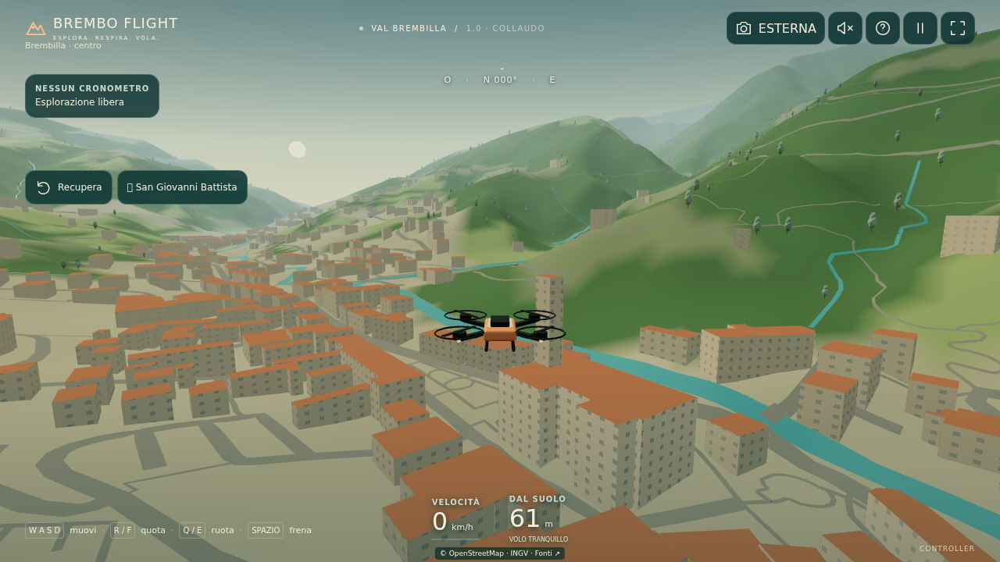
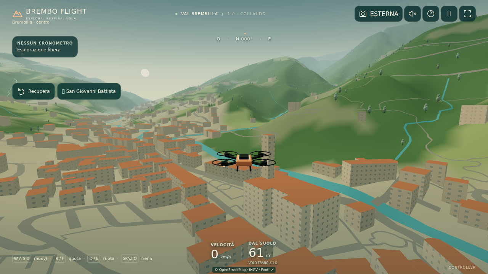

# Confronto reale, stessa inquadratura

Cattura del 16 ottobre 2026, build di produzione. `pr3.png`: PR #3, commit `2a06c243f497436e9f7846f174f9fe1dbce940d9`. `reality-engine.png`: `ff83f0f` più il successivo affinamento del filtro fotografico (strato foto disattivato in entrambe le build). Nessuna immagine generata, foto sovrapposta o teletrasporto del drone.

Differenza reale: altezza relativa DBGT su 36 sagome OSM, mantenendo le basi originali. Il cambiamento è locale e visivamente modesto. Tetti piatti, colori, finestre e vegetazione rimangono illustrativi; non è fotorealismo. Nessuna nuova ortofoto presente.

`comparison.json` conserva matrici di vista/proiezione, risorse e diagnostica. Matrici confrontate numericamente (tolleranza 1e-5). Chromium 153/Linux/SwiftShader, 1280×720, DPR 1, preset Alto. Identica sequenza gamepad simulata, 100 frame a tempo controllato: 40 di salita poi 60 neutri, esplorazione Tranquilla. L'orologio accelerato rende i dati FPS privi di significato: esclusi dal rapporto.

| Misura in questa singola cattura | PR #3 | Altezze DBGT |
| --- | ---: | ---: |
| Triangoli | 209.686 | 209.686 |
| Draw call | 122 | 122 |
| Tessere vettoriali residenti | 32 | 32 |
| Errori JS / caricamento | 0 | 0 |
| Byte trasferiti, encoded body | 591.663 | 598.761 |
| Avvio locale al gioco, ms | 1.209 | 744 |

Tempi di una sola esecuzione locale, influenzati da cache/scheduling: **non dimostrano un'accelerazione**, né prestazioni su telefono. I byte non sono la memoria GPU.

Riproduzione per sviluppatori: checkout separato e immutato della PR #3, installazione/build in entrambi; `BREMBO_BASELINE_DIR=/path/to/pr3 BREMBO_CHROMIUM_EXECUTABLE=/path/to/chromium node scripts/reality-capture.mjs`. Lo script avvia due server locali, salva screenshot e dati e li chiude; non pubblica nulla. Browser standard Playwright se la variabile executable è assente.
