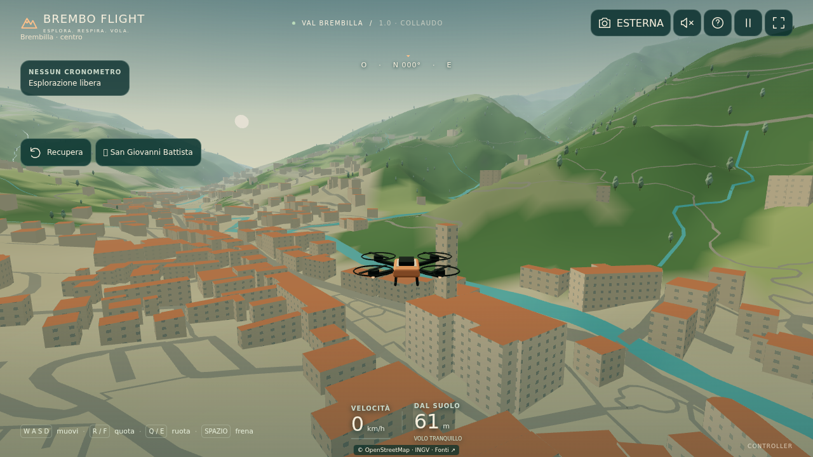
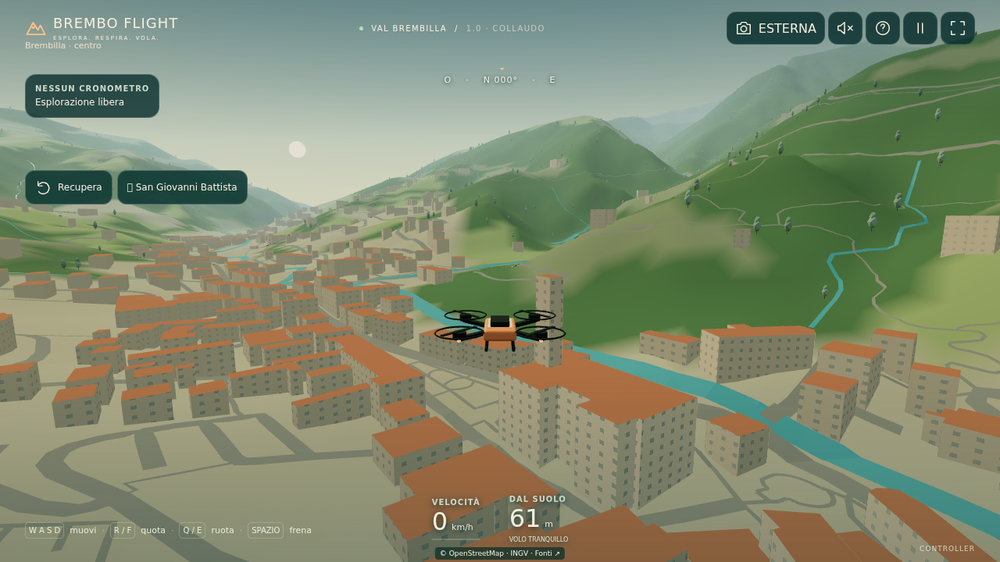

# Missione 2 — altezze DBGT e superfici aderenti

Catture autentiche della build, 16 ottobre 2026. Baseline PR #3 `2a06c24`; candidato `360f72b` più `src/geo/surfaces.ts` / aggiornamento streamer. Protocollo identico al [confronto precedente](../README.md), matrici camera verificate in `comparison.json`, 1280×720 / Alto / DPR 1, Chromium 153 Linux SwiftShader. Nessuna fotografia nuova o generata; paesaggio ancora illustrativo.

Il cambiamento visivo generale è ancora **modesto**: altezze relative di 36 edifici, strade/corsi d'acqua che seguono meglio il terreno. Mancano fotografie contemporanee e forme dei tetti/facciate verificate.

## Difetto geometrico corretto

Le superfici precedenti campionavano il terreno soltanto ai vertici delle linee OSM. Tra questi punti i triangoli potevano attraversare una cresta o scavalcare un avvallamento. Ora ogni triangolo viene diviso sulle celle **e sulle diagonali** della griglia TINITALY già usata da mesh e collisioni. Posizione/larghezza delle linee in pianta restano le stesse; non è una nuova misura della sede stradale. Le larghezze non rilevate, l'offset visivo 0,24/0,36 m e i ponti restano illustrativi. I ponti conservano il precedente trattamento, in attesa di quote reali.

Test sull'intero settore, includendo i duplicati presenti nelle tessere: errore massimo ai punti interni campionati **4,1994 m → 0,000140 m**, al netto dell'offset visivo. Il secondo valore è tolleranza numerica rispetto alla **griglia del gioco**, non precisione topografica. Verificati area in pianta, bordi/diagonali, geometria dei ponti e immutabilità del terreno. Triangoli delle superfici: 59.476 → 172.498 nell'insieme di tutte le tessere, meno di tre volte; non tutti residenti contemporaneamente.

| Cattura stessa camera | PR #3 | Missione 2 |
| --- | ---: | ---: |
| Draw call | 122 | 122 |
| Triangoli visibili | 209.686 | 252.416 |
| Tessere residenti / errori | 32 / 0 | 32 / 0 |
| Byte encoded body trasferiti | 591.663 | 599.237 |
| Avvio locale al gioco, ms | 861 | 645 |

Costo geometrico visibile +20,4%; nessuna nuova draw call, texture o richiesta di rete. Non rivendichiamo un guadagno di velocità dai tempi di una sola esecuzione. Nessun FPS iPhone o 4K misurato. Il preset Eco conserva il limite di 24 tessere; il costo sostenuto su hardware reale resta da collaudare.

Riprodurre con lo script precedente e output `docs/reality-captures/mission2`; `npm test -- --reporter=verbose tests/surfaces.test.ts` ripete anche le misure numeriche.
